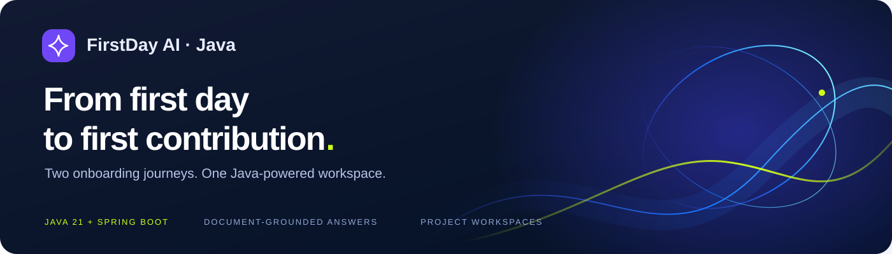
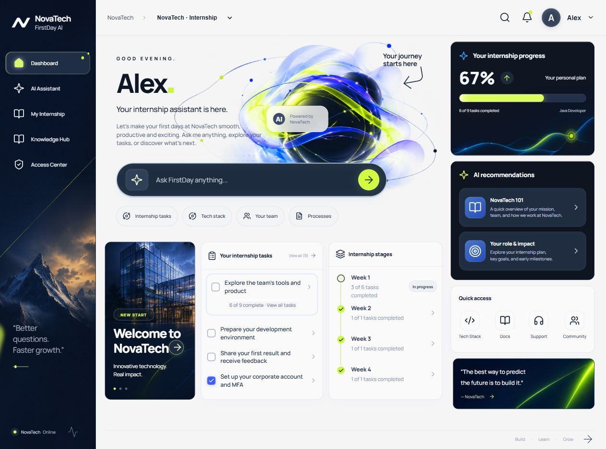
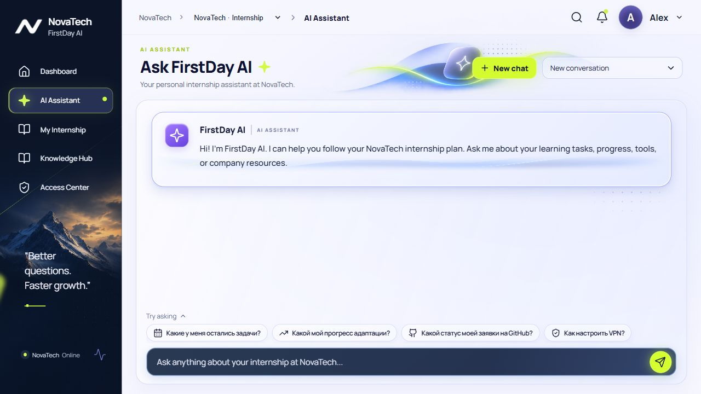
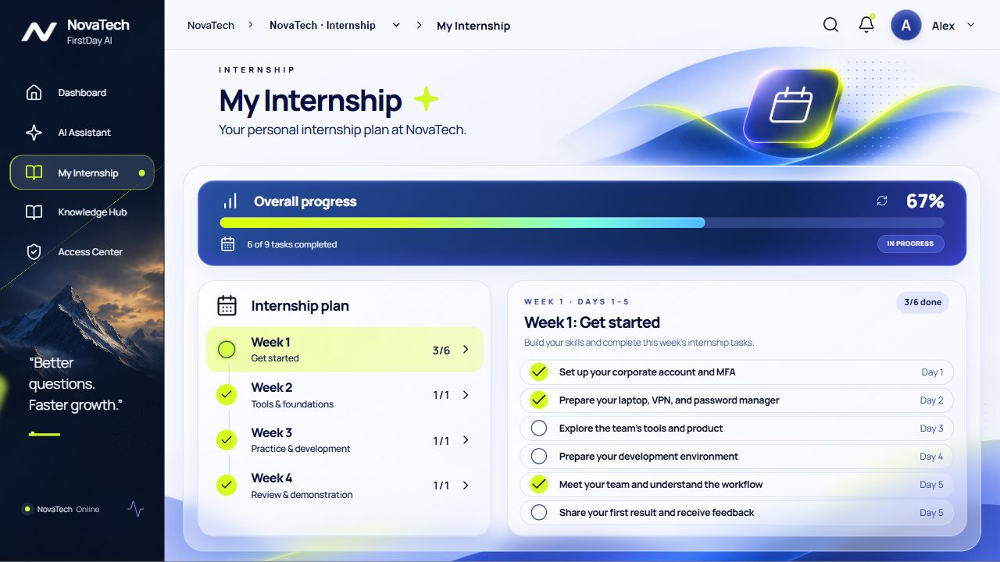
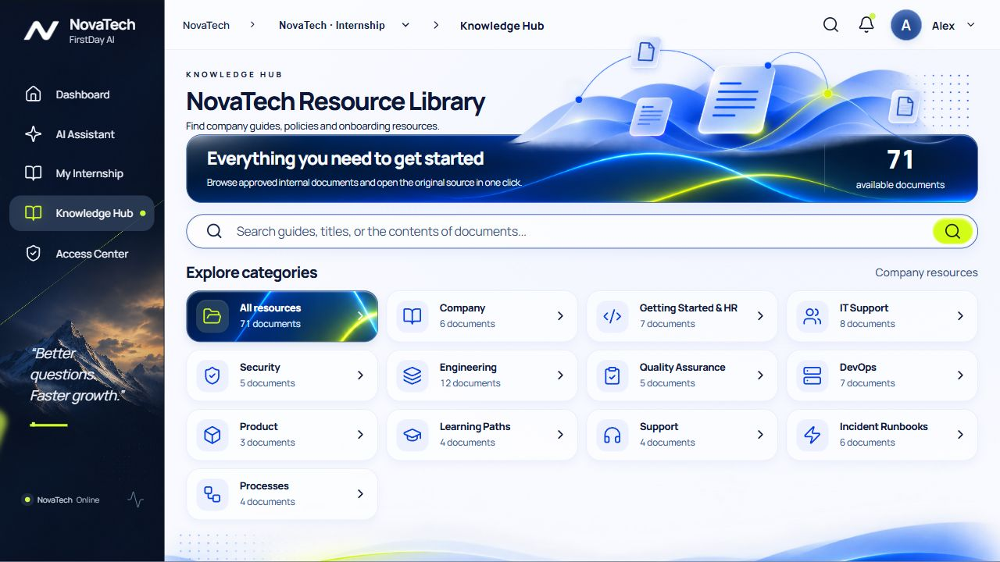
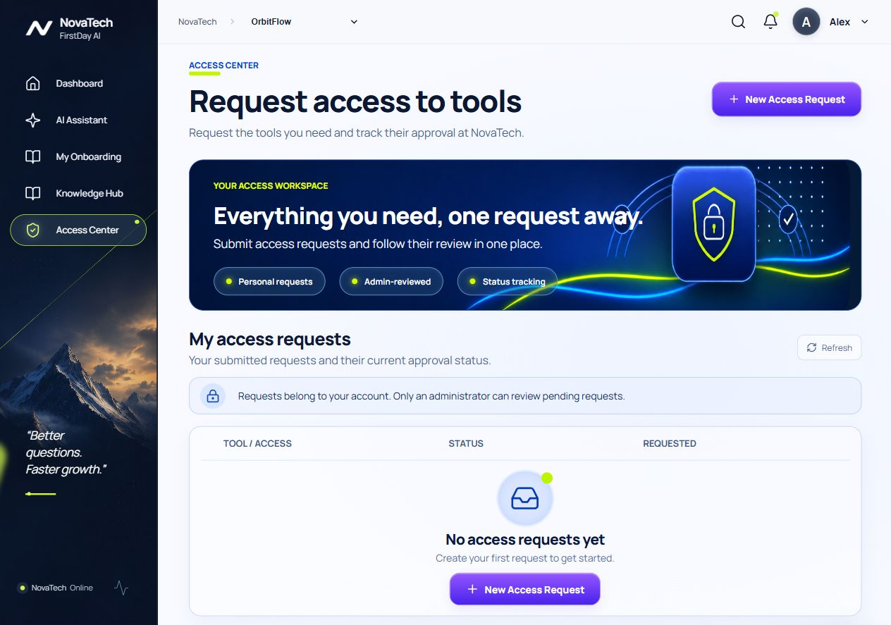
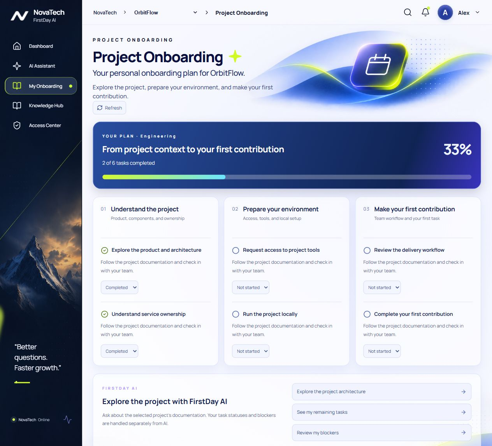

  

<strong>A clear next step for every new teammate.</strong>

Personal learning plans, grounded answers, and project onboarding — powered by a Java backend and local AI.

  
  

  
  
  
  
  

  <a href="#product-tour">Product tour</a> ·
  <a href="#two-journeys-clear-boundaries">Journeys</a> ·
  <a href="#architecture">Architecture</a> ·
  <a href="#testing-and-evidence">Testing</a> ·
  <a href="#run-locally">Quick start</a>

FirstDay AI helps new teammates understand what to do next: follow a personal learning plan, find the right company instruction, request access to tools, or get started on an assigned project.

Built around the fictional company **NovaTech**, this Java edition combines a **Spring Boot backend**, a **React/TypeScript interface**, persistent **PostgreSQL** data, **pgvector** search, and **Ollama** inference. The application backend runs entirely on Java.

## Two journeys, clear boundaries

| | Internship | Project Onboarding |
| --- | --- | --- |
| **Purpose** | Follow a personal learning journey and company procedures. | Get started on a specific assigned IT project. |
| **Plan** | Weekly tasks, completion status, and personal progress. | Context, environment, and contribution stages with role-specific tasks. |
| **AI context** | Training, approved company resources, and the user's own records. | The selected project's authorized documentation and the user's own records. |
| **Boundary** | Project questions and project resources are blocked in this mode. | Active project membership is checked on the server. |
| **History** | Saved conversations, follow-ups, and restored chat selection. | Separate conversation context for each project. |

The mode comes from the authenticated profile. A client-supplied project ID cannot override Internship mode, and selecting a journey never grants administrator privileges.

## Product tour

The screenshots show the application's shared React interface with synthetic preview data. Names, task counts, and progress are illustrative; screenshots are not evidence of live integrations or model answer quality.

<table>
  <tr>
    <td width="50%"><strong>AI Assistant</strong> Saved conversations, contextual follow-ups, and related sources.  </td>
    <td width="50%"><strong>My Internship</strong> A weekly learning plan with visible progress and task completion.  </td>
  </tr>
  <tr>
    <td width="50%"><strong>Knowledge Hub</strong> Search and browse company guides, policies, and learning resources.  </td>
    <td width="50%"><strong>Access Center</strong> Request tools and track administrator review.  </td>
  </tr>
</table>

<strong>Explore the project onboarding route</strong>

Engineering, QA, DevOps/SRE, and General tracks connect project context, environment setup, and a first contribution. Assignments, task statuses, and blockers are stored in PostgreSQL.

## What the application does

| Capability | Implementation |
| --- | --- |
| **Personal answers** | Tasks, progress, blockers, and request statuses come from authorized SQL records. |
| **Grounded knowledge answers** | Relevant documents are selected through lexical and vector retrieval; documented procedures can be extracted directly. |
| **Conversational context** | Recent user and assistant messages resolve quoted and chained follow-ups within the same owned conversation. |
| **Source transparency** | Related resources are displayed beside answers; missing evidence can produce an explicit refusal. |
| **Project assignments** | Administrators assign projects and roles, revoke access, and restore membership while retaining progress. |
| **Persistent workspace** | Accounts, sessions, tasks, requests, memberships, and chats survive restarts. |
| **Local inference** | Chat generation and embeddings use Ollama; a hosted LLM account is not required. |

## Architecture

~~~mermaid
flowchart LR
    UI["React + TypeScript"] --> API["Java 21 / Spring Boot"]
    API --> AUTH["Sessions, roles, mode, membership"]
    AUTH --> ROUTE{"Question context"}
    ROUTE --> PERSONAL["Private records"]
    ROUTE --> INTERN["Internship knowledge"]
    ROUTE --> PROJECT["Assigned project documents"]
    PERSONAL --> DB[("PostgreSQL + pgvector")]
    INTERN --> DB
    INTERN --> ANSWER["Evidence extraction / local generation"]
    PROJECT --> ANSWER
    ANSWER --> OLLAMA["Ollama"]
    ANSWER --> GUARD["Scope validation + related sources"]
    GUARD --> UI
    PERSONAL --> UI
~~~

The server checks the authenticated profile, conversation ownership, and project membership before accessing private context. Internship retrieval excludes project content; a complete Internship answer is checked before it is emitted. Authorized project answers can stream provider deltas.

| Layer | Technology |
| --- | --- |
| **Backend** | Java 21, Spring Boot 3.5, Spring MVC, Jakarta Validation |
| **Persistence** | Spring JDBC, HikariCP, PostgreSQL 17 |
| **Retrieval** | pgvector, 768-dimensional embeddings, lexical matching |
| **Local AI** | Ollama, configurable chat model, nomic-embed-text |
| **Frontend** | React 18, TypeScript, Vite, Lucide icons |
| **Verification** | JUnit 5, Mockito, MockMvc, live PostgreSQL/Ollama scenarios |
| **Automation** | Maven Wrapper and GitHub Actions |

[Architecture and data boundaries →](docs/ARCHITECTURE.md)

## Testing and evidence

**213 checks passed in the recorded local run**, with zero failures, errors, or skipped cases.

| Suite | Cases | Requires running services |
| --- | ---: | --- |
| Unit tests | **131** | No |
| API and simulated-provider contracts | **22** | No |
| PostgreSQL/Ollama integration and answer regression | **60** | Yes |
| **Total** | **213** | |

Checks include authentication, permissions, conversation ownership, Internship/project separation, scoped retrieval, follow-ups, interrupted generation, and real embedding storage through pgvector.

**GitHub Actions runs the 153 fast checks, packages the Java application, and builds the frontend.** The live integration suite is run separately with PostgreSQL and Ollama; a green CI badge does not claim that every local integration scenario ran on GitHub. JUnit reports are uploaded as workflow artifacts.

~~~powershell
# Fast tests and frontend build
.\Test-Project.ps1

# Full suite with initialized PostgreSQL and local Ollama
.\Test-Project.ps1 -Integration
~~~

[Testing guide](docs/TESTING.md) · [Recorded validation](docs/VALIDATION.md) · [JUnit evidence](docs/validation/junit.xml) · [Machine-readable summary](docs/validation/summary.json)

## Run locally

### Requirements

- **JDK 21+** and **Node.js 22+**
- **Docker Desktop** with Docker Compose
- **Ollama**
- Local database credentials in an ignored **.env**

Maven Wrapper is included; a separate Maven installation is not required.

### 1. Clone and configure

~~~powershell
git clone https://github.com/anasteyshaK/firstday-ai-java.git
cd firstday-ai-java
Copy-Item .env.example .env
~~~

Set **DB_PASSWORD** and **PGADMIN_PASSWORD** in your local .env. The placeholders must be replaced; no working credentials are included in the repository.

### 2. Prepare the local services

Start Docker Desktop and Ollama, then run:

~~~powershell
ollama pull nomic-embed-text
ollama pull qwen3:1.7b
docker compose --env-file .env -f db/docker-compose.yml up -d --wait
~~~

### 3. Build and initialize

~~~powershell
.\Build-Backend.ps1
java -jar backend/target/firstday-ai-1.0.0.jar --firstday.command=init
java -jar backend/target/firstday-ai-1.0.0.jar --firstday.command=index
~~~

Initialization creates missing schema objects and prepares synthetic project documentation. Indexing embeds the bundled knowledge documents using local Ollama. Neither operation runs automatically when starting the web server.

### 4. Start the application

In one terminal:

~~~powershell
.\Start-Backend.ps1
~~~

In another:

~~~powershell
.\Start-Frontend.ps1
~~~

| Service | Local address |
| --- | --- |
| Application | http://127.0.0.1:5174 |
| Java API | http://127.0.0.1:8002/api/v1/health |
| Database readiness | http://127.0.0.1:8002/api/v1/ready |
| PostgreSQL | localhost:5435 |
| pgAdmin | http://127.0.0.1:780 |

Register an account through the application. Choose **Internship** for a personal learning journey; project onboarding requires an administrator assignment.

<strong>macOS / Linux</strong>

Use the Maven Wrapper instead of the PowerShell scripts:

~~~bash
cp .env.example .env
# Set your local credentials before starting PostgreSQL.
docker compose --env-file .env -f db/docker-compose.yml up -d --wait
bash backend/mvnw -B -f backend/pom.xml package
java -jar backend/target/firstday-ai-1.0.0.jar --firstday.command=init
java -jar backend/target/firstday-ai-1.0.0.jar --firstday.command=index
java -jar backend/target/firstday-ai-1.0.0.jar
~~~

In another terminal, install and start the frontend:

~~~bash
cd frontend
npm ci
npm run dev
~~~

<strong>Create the first administrator</strong>

First register an account, then run this command in an interactive terminal:

~~~powershell
java -jar backend/target/firstday-ai-1.0.0.jar --firstday.command=promote-admin
~~~

Enter the existing account email and confirm **PROMOTE**. Registration itself never grants administrator privileges.

## Repository guide

~~~text
backend/           Spring Boot application, JUnit tests, Maven Wrapper
frontend/          React and TypeScript application
db/                PostgreSQL/pgvector Compose configuration and SQL
knowledge_base/    Synthetic company and training documentation
docs/              Architecture, testing, validation, and product screenshots
.github/workflows/ Java test, package, and frontend build automation
~~~

## Project scope

This is a local demonstration built around fictional company procedures and synthetic projects. The configured Java database and Docker volumes are independent from the original [Python edition](https://github.com/anasteyshaK/firstday-ai).

Recorded tests provide evidence for the covered scenarios; they do not guarantee every model response. Model quality depends on the installed model and available documentation. The optional Python edition's Langfuse cloud telemetry is not implemented in this edition.

The supplied server binds to localhost. Production deployment requires its own hosting, TLS, operational controls, and backup configuration.

Built to make the next step easier to find.

